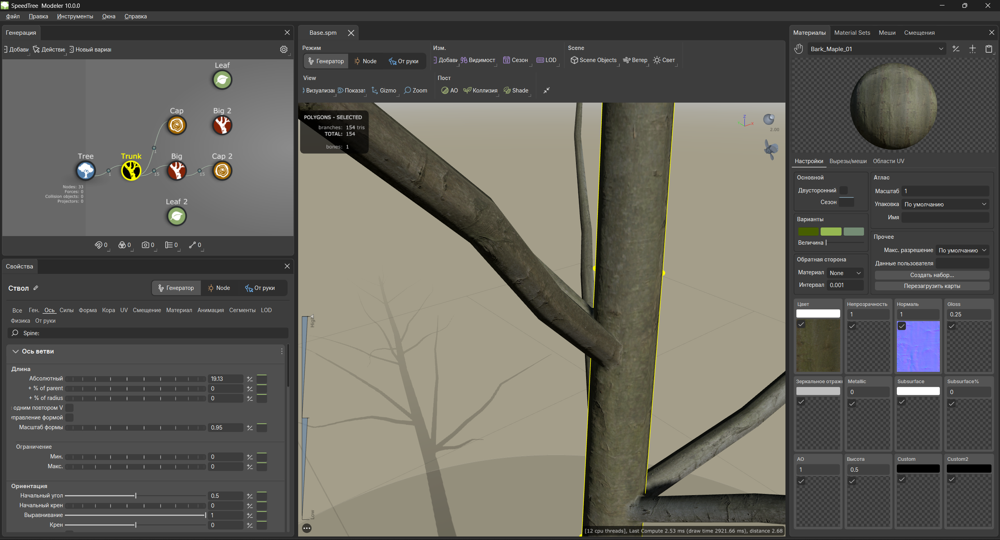

# Русификатор SpeedTree Modeler 10.0.0

Русский интерфейс для **SpeedTree Modeler 10.0.0 под Windows**. Перевод устанавливается заменой двух файлов в папке уже установленной программы.

## Что входит

- `SpeedTree_Modeler.exe` — исполняемый файл с переводом интерфейса.
- `Qt6Gui.dll` — библиотека, поставляемая вместе с русификатором.
- `Ru.png` — скриншот интерфейса после установки.

Часть терминов и названий элементов остаётся на английском — пример перевода показан на скриншоте выше.

## Установка

1. Установите **SpeedTree Modeler 10.0.0**. Этот репозиторий содержит файлы русификатора, а не полный установщик программы.
2. Закройте SpeedTree Modeler.
3. На странице репозитория нажмите **Code → Download ZIP** и распакуйте скачанный архив.
4. Откройте папку установленного SpeedTree, в которой находится `SpeedTree_Modeler.exe`. Её можно найти через ярлык программы: **правой кнопкой → Расположение файла**.
5. Скопируйте оригинальные `SpeedTree_Modeler.exe` и `Qt6Gui.dll` в отдельную папку для резервной копии.
6. Скопируйте **оба файла** из скачанного архива в эту папку SpeedTree и подтвердите замену. Если Windows запросит права администратора для записи в папку программы, подтвердите действие.
7. Запустите `SpeedTree_Modeler.exe` из папки установленной программы.

**Важно:** файлы нужно копировать в папку установленного SpeedTree, а не запускать EXE непосредственно из скачанного архива. Остальные файлы установленной программы должны оставаться на месте.

## Совместимость

Русификатор предназначен для **версии 10.0.0**. Совместимость с другими версиями не проверена. После обновления SpeedTree файлы могут быть заменены обновлением; не устанавливайте их поверх другой версии программы.

## Как вернуть исходную версию

Закройте SpeedTree и верните сохранённые оригинальные `SpeedTree_Modeler.exe` и `Qt6Gui.dll` в папку программы с заменой файлов. Если резервной копии нет, восстановите установку средствами исходного установщика.

## Если возникла проблема

- **Интерфейс не изменился:** проверьте, что заменены оба файла и запускается именно та копия SpeedTree, в которую они были установлены.
- **Программа не запускается:** проверьте версию SpeedTree и расположение файлов. При необходимости восстановите оригинальные файлы из резервной копии.
- **Нашли ошибку перевода:** создайте [Issue](https://github.com/INU-ez/RU_SpeedTree-v10.0.0/issues), укажите текст ошибки, где она находится, и приложите скриншот.
